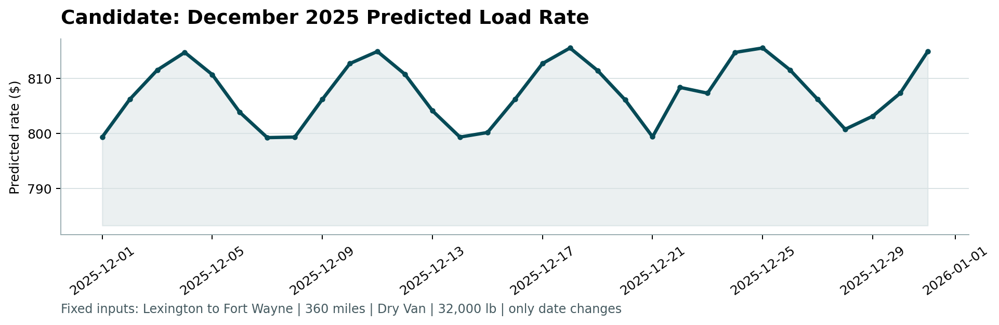

# 🚚 Freight Rate Prediction

Predicting truckload freight rates (`posted_rate`) for loads in November–December 2025, using 48,000 historical loads from January–October 2025.

## 📊 Results

Tested on a time-based holdout: trained on Jan–Aug, evaluated on Sep–Oct.

| Model | MAE ($) | MAPE (%) |
|---|---|---|
| Overall median rate per mile × distance | 203.7 | 9.27 |
| Median rate per mile per equipment × distance | 175.1 | 8.09 |
| Linear regression | 110.8 | 4.66 |
| **Gradient boosting (final model)** | **74.1** | **2.99** |
| Gradient boosting without `quote_signal` (used for December) | 105.1 | 4.38 |

## ⚙️ How to run

Python 3.10+. From the project root:

```bash
python -m venv .venv
.venv\Scripts\activate          # Windows
# source .venv/bin/activate     # macOS / Linux
python -m pip install -r requirements.txt
```

The data files are not included in this repo since they were provided privately for the assessment. Place them in a `data/` folder:

```
data/train_test.csv
data/validation.csv
data/validation_predictions_template.csv
data/december_chart_inputs.csv
```

Then train, predict and validate:

```bash
python src/train.py
python score.py --predictions validation_predictions.csv --december-predictions data/december_chart_inputs.csv
```

`train.py` prints the holdout scores, writes `validation_predictions.csv`, and fills `predicted_rate` in `data/december_chart_inputs.csv` (a copy is saved as `december_predictions.csv`). `score.py` checks both files and creates `scorer_results/candidate_december.png`.

## 🛠️ Data issues and fixes

| Issue | What I did |
|---|---|
| 292 negative weights | Treated as sign errors and flipped to positive |
| Missing weight (300) and market_index (374) | Weight filled with the median per equipment type; market_index filled with that day's average (it's essentially one value per day) |
| 672 loads (1.4%) priced over 2x or under 0.5x their route's typical rate per mile | Removed from training |
| 111 distances looked too long compared to the coordinates | Investigated: all on short routes, and distance is consistent across every load on each route. The coordinates are approximate, not the distances wrong, so no change |
| 1,191 loads at exactly 47,500 lb | Plausible maximum load, kept |
| 8 cities in validation never appear in training (1,447 rows) | Model uses coordinates and distance instead of city names |
| December inputs have no coordinates, market_index or quote_signal | Coordinates from a city lookup, market_index from that day's value in `validation.csv`, and a separate model without `quote_signal` |

## 💡 Approach

- **Time-based split.** Validation is entirely in the future (Nov–Dec), so I held out the last two months of training (Sep–Oct) instead of a random sample. A random split would let the model see days around each test load and overstate accuracy.
- **Predict rate per mile, not total price.** Price scales with distance, so the model learns rate per mile and multiplies back by distance. This beat predicting the price directly.
- **Gradient boosting** (`HistGradientBoostingRegressor` from scikit-learn). It handles non-linear effects and interactions between distance, equipment and market conditions, trains in seconds, and needs no extra dependencies.
- **Features:** distance, weight, equipment, pickup/delivery coordinates, market_index and quote_signal.
- **Tried and dropped:** day of week (3.21% vs 2.99% without it, since the market index already captures the weekly cycle).
- **New cities check:** hiding 8 cities from training gave 3.06% MAPE on routes involving them, close to the overall 2.99%.
- **Final models** are retrained on all cleaned Jan–Oct data before predicting.

## 📅 December chart



Only the date changes, so predictions follow the daily market index: a smooth weekly cycle between $799 and $816, close to this route's historical median of about $808.

## ⚠️ Limitations and next steps

- Training data covers only Jan–Oct, so the model has never seen the Christmas period and has no holiday effect. With a full year of history I'd add holiday features.
- No hyperparameter tuning yet. Tuning with time-series cross-validation would be the next step.
- Price outliers are removed with a simple rule. On routes with very few loads it can't detect them.

## 📁 Project structure

```
├── notebooks/
│   └── exploration.ipynb      # data exploration, cleaning, experiments
├── src/
│   └── train.py               # final pipeline: clean, train, predict
├── scorer_results/
│   └── candidate_december.png
├── validation_predictions.csv # final predictions for the 12,000 validation loads
├── december_predictions.csv   # filled December chart inputs
├── score.py                   # provided scorer
└── requirements.txt
```